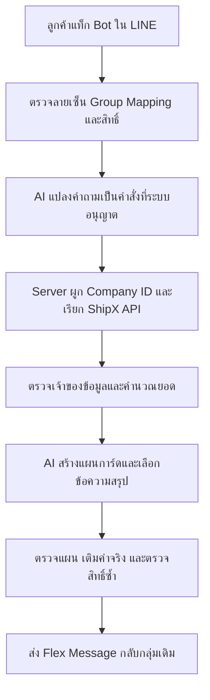

# ตั้งค่าและสอน AI สำหรับ ShipX LINE Bot

อัปเดต 5 พฤศจิกายน 2026 เวลาไทย คู่มือนี้ใช้กับโค้ดบน branch `codex/shipx-line-bot-v2` ต้องนำโค้ดรุ่นนี้ขึ้นระบบก่อนจึงจะมีปุ่มและตัวแปรครบตามคู่มือ

## 1. AI ทำงานตรงไหน



ตัวอย่าง: ลูกค้าถาม “วันนี้ต้องส่งกี่ออเดอร์ แพ็คไปเท่าไหร่”

- AI เลือกคำสั่ง `get_shipping_progress`
- Server ใช้ Company ID จากกลุ่ม และ ShippingDate ของวันที่เลือก เรียก `POST /api/v3/Order/list/order-platform` ให้ครบทุกหน้า แล้วตรวจบริษัทกับวันที่ของแต่ละออเดอร์
- ถ้าตรวจได้ว่าต้องส่ง 8 แพ็คเสร็จ 4 ระบบคำนวณเป็น 50% ข้อมูลที่ตรวจสถานะไม่ได้แสดงแยก
- AI ช่วงที่สองเลือกหัวข้อ ข้อความสรุป และลำดับแสดงข้อมูลจาก schema ที่อนุญาต เช่น `แพ็คเสร็จแล้ว {{packed}} ออเดอร์` แล้ว Server เติม 4 จากข้อมูลจริง

AI ไม่ได้รับสิทธิ์เลือกบริษัทเอง ไม่มีเครื่องมือแก้สต๊อก/ออเดอร์ และไม่ได้คำนวณจำนวนจากความจำของโมเดล ตัวเลขและค่าจาก ShipX ถูกเติมโดย Server หลังตรวจแผนตอบกลับ

วิธีเชื่อมใช้ [Function calling](https://developers.openai.com/api/docs/guides/function-calling) สำหรับเลือกคำสั่ง และ [Structured Outputs](https://developers.openai.com/api/docs/guides/structured-outputs) สำหรับสร้างแผนการ์ด

## 2. ต้องสร้าง AI ใหม่ไหม

เริ่มด้วยโมเดลที่มีอยู่แล้วผ่าน OpenAI API จากนั้นสอนพฤติกรรมด้วยคำสั่ง ตัวอย่าง และความรู้เฉพาะ ShipX ในโปรเจกต์นี้ การแก้ไฟล์คำสอนมีผลกับคำขอหลัง restart/redeploy โดยไม่ต้องสร้างโมเดลของตัวเอง

| วิธี | ใช้กับอะไร | โปรเจกต์นี้ทำอะไรแล้ว |
| --- | --- | --- |
| Prompt + ตัวอย่าง | สอนให้ตีความคำถามและเลือกวิธีตอบ | `src/ai-policy.json` |
| ความรู้ที่ตรวจแล้ว | แปลรหัสสถานะและความหมายของฟิลด์ | `src/status.js` และ `domainNotes` ใน policy |
| API สด | จำนวนออเดอร์ สต๊อก และรายงาน ณ ตอนถาม | `src/shipx.js` |
| Fine-tuning น้ำหนักโมเดล | ปรับพฤติกรรมจากชุดข้อมูลเฉพาะจำนวนมาก | ยังไม่มีงานฝึกน้ำหนักในโปรเจกต์นี้ |

การวาง PDF ในโฟลเดอร์อย่างเดียวไม่ได้ทำให้โมเดลเรียนรู้ไฟล์โดยอัตโนมัติ ตอนนี้ใช้ Appendix ที่ตรวจแล้วแปลงเป็นตารางสถานะในโค้ด หากเพิ่มเอกสารให้เลือกส่วนที่เกี่ยวข้องมาตรวจและเพิ่มความรู้/ตารางก่อน เอกสารจำนวนมากอาจต่อยอดเป็นระบบค้นคืนเนื้อหา (RAG) ได้ในอนาคต ส่วนข้อมูลออเดอร์และสต๊อกที่เปลี่ยนตลอดให้อ่าน API

## 3. สร้าง Project และ API Key

1. เข้า [OpenAI Platform](https://platform.openai.com/) ด้วยบัญชีของบริษัท
2. สร้างหรือเลือก Project เช่น `ShipX LINE Bot`
3. ให้ผู้ดูแลตรวจ Billing/โควตา และสิทธิ์ใช้โมเดลของ Project
4. สำหรับระบบบริษัทที่ deploy แล้ว ใช้ Service Account ของ Project และสร้าง API key สำหรับแอปนี้ ให้มีสิทธิ์เรียก Responses API และโมเดลที่ต้องการ บัญชีทดลองในเครื่องอาจใช้ Project API key ของผู้พัฒนาได้
5. เก็บคีย์ไว้ในตัวแปรของระบบฝั่ง Server ไม่วางในไฟล์หน้าเว็บ GitHub หรือแชต

แนวทางนี้อ้างอิง [API keys and service accounts](https://developers.openai.com/api/docs/guides/api-keys) ซึ่งแนะนำ Service Account สำหรับแอปและงานที่ deploy

## 4. ตั้งค่าที่ Coolify

1. เปิด `https://coolify.tks.co.th/`
2. ไปทีม **Information Technology → ShipX → แอป LINE Bot เดิม**
3. เปิด **Environment Variables**
4. ตั้งค่าต่อไปนี้ โดยใส่คีย์จริงใน Coolify:

```dotenv
OPENAI_API_KEY=ใส่คีย์จริงในช่องนี้
OPENAI_MODEL=gpt-4o-mini
OPENAI_RESPONSE_MODEL=gpt-4o-mini
AI_RESPONSE_ENABLED=true
SHIPX_SHIPPING_DATE_IS_DUE_DATE=true
```

- `OPENAI_MODEL`: โมเดลแปลคำถามเป็นคำสั่ง
- `OPENAI_RESPONSE_MODEL`: โมเดลจัดคำตอบ ถ้าเว้นว่างจะใช้ `OPENAI_MODEL`
- `AI_RESPONSE_ENABLED=true`: เปิด AI ช่วงจัดคำตอบ ถ้าเป็น `false` ยังให้ AI แปลคำถามได้ แต่ใช้การ์ดมาตรฐานตอบ
- `SHIPX_SHIPPING_DATE_IS_DUE_DATE`: ยืนยันความหมาย ShippingDate ที่ใช้เป็นกำหนดส่งตามที่ผู้ใช้ยืนยันไว้

5. Save แล้ว **Redeploy** เพื่อให้ Server โหลดตัวแปรใหม่
6. เปิดหน้า Admin ของ Bot → **การเชื่อมต่อ** ดูสถานะ “AI แปลคำถามเป็นคำสั่ง” และ “AI สร้างแผนการ์ดตอบกลับ”
7. กด **ทดสอบ AI (เรียก API)** จะใช้ข้อมูลตัวอย่างทดสอบสองช่วง มีค่าใช้งาน OpenAI API แต่ไม่ส่งข้อความ LINE และไม่อ่านข้อมูลจริงจาก ShipX ผลที่ควรได้คือ “แปลคำถาม: ผ่าน · สร้างแผนการ์ด: ผ่าน”
8. ทดสอบใน LINE Group ที่เปิดสิทธิ์แล้ว เช่น เลือกแท็ก Bot แล้วพิมพ์ “ออเดอร์ SO001 ให้หน่อย” หรือ “วันนี้ต้องส่งกี่ออเดอร์ แพ็คไปเท่าไหร่” เปลี่ยนเลขตัวอย่างให้ตรงกับออเดอร์ของกลุ่ม

สถานะ “ตั้งค่าแล้ว” หมายถึงมีคีย์และเปิดฟังก์ชัน ไม่ได้ยืนยันว่าคีย์ใช้ได้ จึงต้องกดทดสอบด้วย หากไม่ผ่านให้ตรวจคีย์ สิทธิ์ของโมเดล โควตา และการเชื่อมต่อออกไป OpenAI ในระบบ

ค่าโมเดลข้างบนคงค่าเดิมของโปรเจกต์ไว้ ไม่ใช่การรับรองว่าเป็นโมเดลล่าสุด ณ วันที่เขียนคู่มือ OpenAI ประกาศยุติ GPT-4o mini ในวันที่ 14 มกราคม 2027 จึงควรเลือกโมเดลที่บัญชีใช้ได้และรองรับ Function calling กับ Structured Outputs แล้วทดสอบชุดคำถามก่อนเปลี่ยนค่า ดู [ประกาศ Deprecations](https://developers.openai.com/api/docs/deprecations)

## 5. ตั้งค่าและลองบนเครื่อง

สร้างหรือแก้ไฟล์ `.env` ใน `C:\ShipX-Line-Bot` ตาม `.env.example` ใส่คีย์ในไฟล์นี้ ห้าม commit ไฟล์ `.env`

- `npm run demo` ใช้ข้อมูลตัวอย่างและปิด OpenAI / LINE / ShipX จริง แม้ตั้งคีย์แล้ว
- `npm start` ใช้การตั้งค่าระบบจริง จึงต้องมีค่า LINE และ ShipX ด้วย
- ถ้าต้องการทดสอบ OpenAI ด้วยข้อมูลตัวอย่างโดยไม่ต้องต่อ LINE/ShipX ให้ใช้ชุดทดสอบด้านล่าง

```powershell
cd C:\ShipX-Line-Bot
npm run ai:eval
```

คำสั่งนี้ทดสอบ 12 รูปแบบคำถามกับตัวแปลคำสั่งในเครื่อง และตรวจการเติมค่าจริงในการ์ด ไม่มีการเรียก API ภายนอก

หากต้องการยืนยันว่าโมเดลจริงทำได้ หลังใส่คีย์ใน `.env`:

```powershell
npm run ai:eval -- --live
```

คำสั่ง `--live` เรียก OpenAI ด้วยชุดข้อมูลจำลองและมีค่าใช้งาน ไม่เรียก ShipX และไม่ส่ง LINE รายงานอยู่ที่ `artifacts/ai-eval-report.json` ต้องได้คำถาม 12/12 และ presentation PASS โหมด live ตรวจว่าตัวโมเดลเลือกคำสั่งได้จริง จึงไม่ใช้ความสำเร็จของ fallback มานับเป็นความสำเร็จของ AI

## 6. สอนให้เข้าใจภาษาลูกค้าเพิ่ม

แก้ไฟล์ `src/ai-policy.json` ซึ่งมีส่วนต่อไปนี้:

| ส่วน | ใช้ทำอะไร |
| --- | --- |
| `plannerInstructions` | กติกาหลักในการแปลงคำถามเป็นเครื่องมือ |
| `plannerExamples` | ตัวอย่างคำถามและเครื่องมือที่ถูกต้อง |
| `extraThaiVocabulary`, `extraEnglishVocabulary` | เพิ่มคำศัพท์ทั่วไปที่ใช้ในคำถาม ระบบส่งให้ AI หลังแทนเลขอ้างอิงแล้ว |
| `domainNotes` | ความหมายฟิลด์และข้อกำหนด ShipX |
| `presenterInstructions` | กติกาการจัดแผนการ์ดตอบกลับ |
| `responseTemplates` | ประโยคสรุปที่มีตัวแปร เช่น `{{packed}}` |
| `titles` | ตัวเลือกหัวข้อของการ์ดแต่ละประเภท |

ตัวอย่างเพิ่มใน `plannerExamples`:

```json
{
  "question": "รบกวน ดู [REF_1] ถึง ไหน แล้ว",
  "tool": "lookup_order"
}
```

ใช้ `[REF_1]` แทนเลขออเดอร์หรือ SKU จริง ตัวอย่างจะถูกแนบในคำสอนทุกครั้งที่เรียก AI วางเฉพาะตัวอย่างที่ผ่านการตรวจแล้ว การเพิ่มชื่อเครื่องมือในตัวอย่างไม่สามารถสร้าง API ใหม่หรือขยายสิทธิ์บริษัทได้

ตัวอย่างประโยคตอบที่เพิ่มได้ใน `responseTemplates.shipping`:

```json
"เช็กให้แล้วครับ รอบนี้ต้องส่ง {{due}} ออเดอร์ และแพ็คเสร็จแล้ว {{packed}} ออเดอร์"
```

ห้ามพิมพ์ยอดจริง เช่น “แพ็คแล้ว 100” ลงในเทมแพลต ให้ใช้ตัวแปรที่มีอยู่ใน `src/replies.js` เท่านั้น ประโยคสรุปต้องตรงกับความหมายของค่าและรองรับกรณียอดเป็นศูนย์หรือมีสถานะที่ตรวจไม่ได้ด้วย

หลังแก้ให้รัน:

```powershell
npm run check
npm test
npm run ai:eval
```

เพิ่มคำถามทดสอบที่ยังไม่เคยใส่ในคำสอนลง `test/fixtures/ai-eval.json` แยกจากตัวอย่างสอน เมื่อผ่านแล้วจึง restart/redeploy และลอง live test อีกครั้ง การรีเฟรชหน้าเว็บอย่างเดียวไม่โหลดไฟล์คำสอนใหม่

## 7. ถ้าต้องการ Fine-tuning จริง

การปรับคำสอนและตัวอย่างข้างบนไม่ได้เปลี่ยนน้ำหนักโมเดล หากยังมีข้อผิดพลาดซ้ำหลังปรับคำสอน ควรรวบรวมคำถามที่ลบข้อมูลส่วนบุคคลแล้ว ติดป้ายคำตอบที่ถูกต้อง และแยกชุดฝึกออกจากชุดทดสอบเพื่อประเมินก่อน/หลัง

ณ 5 พฤศจิกายน 2026 OpenAI จำกัดการสร้างงาน self-serve fine-tuning สำหรับองค์กรใหม่และองค์กรที่ไม่มีการใช้งานตามเกณฑ์ และประกาศหยุดสร้างงานใหม่ของลูกค้าเดิมที่ยังมีสิทธิ์ในวันที่ 6 มกราคม 2027 จึงต้องตรวจสิทธิ์บัญชีตาม [ประกาศล่าสุด](https://developers.openai.com/api/docs/deprecations) ก่อนวางแผนฝึก ไม่ควรเริ่มด้วยขั้นตอนสร้าง fine-tuning job ที่บัญชีอาจใช้ไม่ได้

สำหรับ ShipX รุ่นนี้ แนวทางที่ทำไว้คือคำสอน + ตัวอย่าง + ตารางความรู้ที่ตรวจแล้ว + API สด + การทดสอบ ช่วยเปลี่ยนพฤติกรรมได้โดยไม่ผูกกับระบบฝึกน้ำหนัก และอัปเดตข้อมูลออเดอร์ได้ทันที

## 8. ตรวจว่าใช้ AI จริงหรือใช้ fallback

- หน้า **ประวัติการใช้งาน** แสดง “AI แปลงคำถามเป็นคำสั่ง” และ “AI จัดการ์ดตอบกลับ”
- ผล `selected` / `generated` หมายถึงได้คำสั่งหรือแผนตอบจาก AI ที่ตรวจผ่าน
- ผล `fallback` หมายถึงใช้ตัวแปลหรือการ์ดมาตรฐาน อาจเกิดจากคีย์ โมเดล โควตา timeout หรือแผนตอบที่ตรวจไม่ผ่าน
- หากไม่มีแท็ก Bot ในข้อความทั่วไป จะไม่เริ่มทั้งสองช่วง ข้อยกเว้นคือรอบแจ้งเตือนอัตโนมัติที่เปิดไว้ในกลุ่ม
- หากเปลี่ยนบริษัทหรือถอนสิทธิ์ระหว่างรอ AI ระบบจะไม่ส่งข้อมูลของบริษัทเดิมออกไป

สิ่งที่ส่งให้ OpenAI ช่วงแรกคือคำศัพท์คำถามที่คัดแล้วพร้อมตัวแทนเลขอ้างอิง ช่วงที่สองคือยอดสรุปที่ตรวจแล้วกับรหัสตำแหน่งในเทมแพลต ไม่ส่ง raw response ของ ShipX, Company ID, ชื่อลูกค้า, ที่อยู่, เบอร์โทร, ชื่อสินค้า หรือเลขออเดอร์จริง ตั้ง `store:false` ทั้งสองช่วง แต่การตั้งค่านี้ไม่ได้แทนที่นโยบายการเก็บข้อมูลของผู้ให้บริการทั้งหมด
